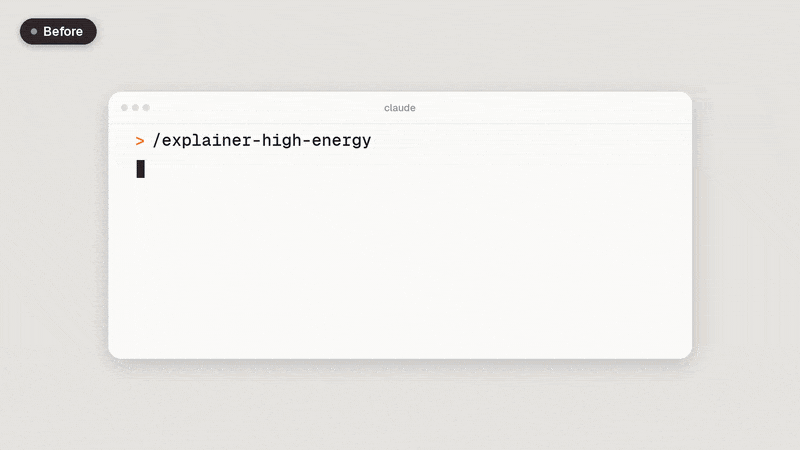
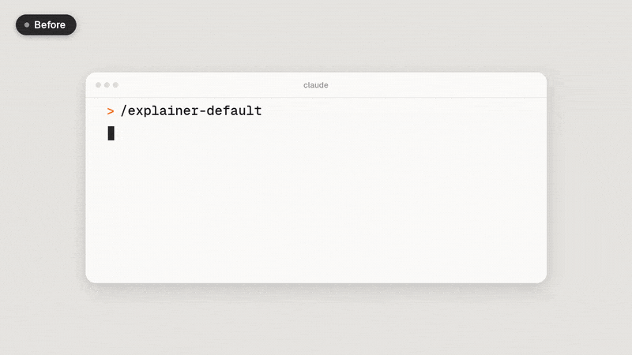
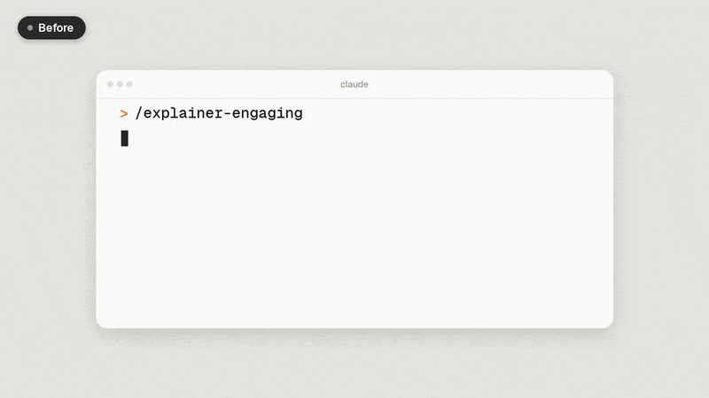
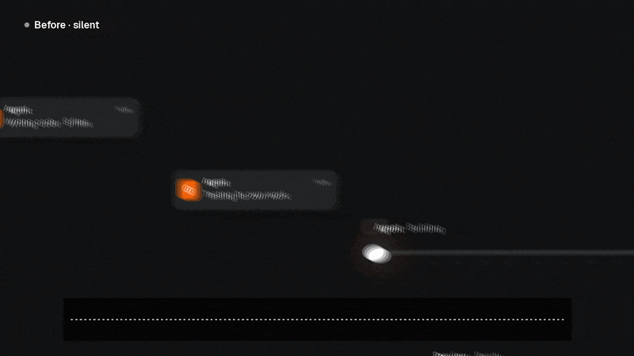

# motion-graphics

Free video-editing skills for Claude Code. Each skill does one job.

## Skills

| Skill | What it does |
|---|---|
| [`motion-broll`](skills/motion-broll/README.md) | Give it a video and a transcript and it makes motion-graphic B-roll timed to your words. |
| [`object-separation`](skills/object-separation/README.md) | Separates a person, product or hand from the background in a video, on your own computer. |
| [`explainer-high-energy`](skills/explainer-high-energy/README.md) | A 12–20 s hype promo for any product: beat-locked kinetic type and shape transitions. |
| [`explainer-default`](skills/explainer-default/README.md) | A clean 45–90 s product demo: your product's UI rebuilt and filmed up close while it's used. |
| [`explainer-engaging`](skills/explainer-engaging/README.md) | A 10–30 s one-take story: one element travels through your product's workflow. |
| [`sound-effects`](skills/sound-effects/README.md) | Adds real sound effects timed to the beat and measured, so it doesn't sound like cheap beeps. |

> **Want the full course?** I teach my entire AI video editing process step by step in my community: **[Join Bart's AI Workshop on Skool](https://www.skool.com/barts-ai-workshop-4507/about)**

## Install

```
npx skills add Barty-Bart/motion-graphics
```

Pick the skills you want. It works in Claude Code and other agents that read skills. Or copy a skill's folder from `skills/` into `.claude/skills/`.

## Examples

### motion-broll

<p align="center"></p>

[Full guide →](skills/motion-broll/README.md)

### object-separation

<p align="center"></p>

[Full guide →](skills/object-separation/README.md)

### explainer-high-energy

<p align="center"></p>

[Full guide →](skills/explainer-high-energy/README.md)

### explainer-default

<p align="center"></p>

[Full guide →](skills/explainer-default/README.md)

### explainer-engaging

<p align="center"></p>

[Full guide →](skills/explainer-engaging/README.md)

### sound-effects

<p align="center"></p>

[Full guide →](skills/sound-effects/README.md)

## Licence

MIT. Geist fonts: SIL Open Font License. Icon paths adapted from Lucide (ISC). Sound effects in `skills/sound-effects/sfx/`: CC0 1.0 (see that skill's [`LICENSES.md`](skills/sound-effects/LICENSES.md)). Sound-pass method by Vox ([@Voxyz_ai](https://x.com/Voxyz_ai/status/2109358372873183564)); full credits are in each skill's README.
